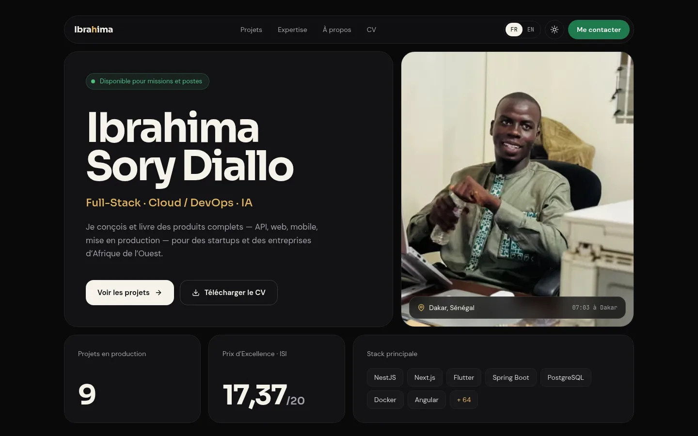

# Portfolio d'Ibrahima Sory Diallo

Portfolio bilingue (français / anglais) de développeur Full-Stack basé à Dakar : projets en production, études de cas, parcours, compétences, CV imprimable et formulaire de contact. Design « Bento immersif » : cartes en grille, grande typographie, or et vert du drapeau sénégalais sur fond obsidienne ou ivoire, en thème sombre et clair.

**Site en ligne : [ibrahima-devs-portfolio.vercel.app](https://ibrahima-devs-portfolio.vercel.app)**



---

## Fonctionnalités

- **Deux langues** : français à la racine (`/about`), anglais sous `/en` (`/en/about`), sélecteur FR | EN qui garde la page courante. Tous les textes, dates et nombres suivent la langue.
- **Accueil en bento** : identité, photo avec l'heure de Dakar, chiffres clés, stack, projets mis en avant, parcours et expertise, compétences, services et méthode, témoignages, contact.
- **Projets** (`/projects`) : filtres par catégorie et études de cas (`/projects/[slug]`) avec architecture, défis techniques, extrait de code et image de partage par projet et par langue.
- **À propos** (`/about`) et **CV** (`/cv`) : parcours en frise, distinctions, compétences ; CV rendu côté serveur, imprimable en A4 et disponible en PDF.
- **Formulaire de contact** : envoi par [Resend](https://resend.com), erreurs affichées dans la langue de la page, protection anti-spam (champ piège, délai minimal, limitation de débit par IP).
- **Animations sobres** : entrée de l'accueil en CSS, apparition au défilement, transition de l'image d'un projet vers son étude de cas ; toutes coupées par « réduire les animations ».
- **Thème sombre / clair**, contrastes conformes WCAG AA ; navigation au clavier, lien d'évitement, menu mobile accessible.
- **SEO** : URL canonique et versions `hreflang` par page, images Open Graph générées, sitemap bilingue, robots.txt, données structurées `Person`.

## Stack

| Couche | Technologies |
| :--- | :--- |
| Framework | Next.js 16 (App Router, Turbopack), React 19, TypeScript 5 |
| Style | Tailwind CSS 4 |
| Animations | Framer Motion 14, animations CSS |
| Formulaire | Resend, Zod 4 |
| Tests | Vitest (unitaires), Playwright (de bout en bout) |
| Qualité | ESLint, Prettier, GitHub Actions, Dependabot |

## Démarrage

Prérequis : Node.js 20.19 ou plus.

```bash
git clone https://github.com/IbrahimaISIDev/ibrahima-diallo-portfolio-premium.git
cd ibrahima-diallo-portfolio-premium
npm install
cp .env.example .env.local   # puis renseigner les variables
npm run dev                   # http://localhost:3000
```

### Variables d'environnement

| Variable | Rôle |
| :--- | :--- |
| `RESEND_API_KEY` | Clé API Resend, **obligatoire** pour que le formulaire envoie des emails |
| `CONTACT_TO` | Adresse qui reçoit les messages (par défaut : l'email de `content/profile.ts`) |
| `CONTACT_FROM` | Expéditeur, sur un domaine vérifié dans Resend (par défaut : l'adresse de test `onboarding@resend.dev`, qui ne délivre qu'au propriétaire du compte) |

## Scripts

| Commande | Rôle |
| :--- | :--- |
| `npm run dev` | Serveur de développement |
| `npm run build` / `npm start` | Build et serveur de production |
| `npm run lint` | ESLint |
| `npm run typecheck` | Vérification TypeScript |
| `npm run format` / `npm run format:check` | Formatage Prettier |
| `npm test` | Tests unitaires (route de contact, langues, métadonnées) |
| `npm run test:e2e` | Tests de bout en bout sur le build de production (lancer `npm run build` avant ; en local, `CHROME_PATH` permet d'utiliser le Chrome installé) |

## Modifier le contenu

Le contenu est dans `content/`, les textes de l'interface dans `lib/i18n/dictionaries.ts` : pas besoin de toucher aux composants. Chaque texte existe en français et en anglais (`{ fr: "…", en: "…" }`) ; un nom propre ou une technologie peut rester une simple chaîne. TypeScript signale toute traduction manquante.

| Fichier | Contenu |
| :--- | :--- |
| `content/profile.ts` | Identité, contact, réseaux, titres, accroche, résumé, chiffres clés, distinctions |
| `content/experience.ts` | Parcours professionnel et formation (`type: "work"` ou `"education"`, dates `AAAA-MM`) |
| `content/projects.ts` | Projets et études de cas ; `featured` les met en avant sur l'accueil, les filtres sont déduits des catégories |
| `content/skills.ts` | Compétences groupées par domaine, et la stack principale de l'accueil |
| `content/services.ts` | Services proposés |
| `content/testimonials.ts` | Témoignages (citation originale en français, lien LinkedIn optionnel) |
| `content/workflow.ts` | Étapes de la méthode de travail |
| `lib/i18n/dictionaries.ts` | Textes de l'interface et métadonnées de chaque page ; l'anglais doit avoir la même forme que le français |
| `public/images/` | Photo de profil et captures des projets (WebP recommandé) |
| `public/cv/` | CV au format PDF |

## Structure

```
app/[lang]/   Pages de chaque langue (accueil, projets, études de cas, à propos, CV, contact, 404)
              et images de partage ; next.config.ts sert le français à la racine
app/          Route API de contact, icônes, manifeste, sitemap, robots.txt, styles globaux
components/   site/ (header, menu, footer, langue), home/, projects/, about/, cv/, contact/,
              ui/ (cartes, boutons, typographie), motion/ (apparition au défilement), shared/
content/      Contenu bilingue et sa mise en forme par langue (getContent)
lib/          i18n/ (langues, dictionnaires), métadonnées, navigation, images de partage, utilitaires
tests/        unit/ (Vitest) et e2e/ (Playwright)
docs/         Rapport d'audit et brief initial du projet
```

## Qualité et déploiement

Chaque push sur `main` et chaque pull request lancent la CI GitHub Actions : lint, formatage, types, tests unitaires, build, tests de bout en bout et audit des dépendances de production. Dependabot propose les mises à jour chaque semaine.

Le site se déploie sur [Vercel](https://vercel.com) sans configuration particulière : il suffit de renseigner les variables d'environnement ci-dessus dans le projet Vercel.

## Documentation

- [`docs/AUDIT.md`](docs/AUDIT.md) : audit complet du projet (66 constats, plan d'action en trois phases, suivi des corrections et refonte).
- [`docs/brief-initial.md`](docs/brief-initial.md) : brief de conception d'origine (objectifs, cibles, direction artistique).

---

## Contact

**Ibrahima Sory Diallo**  
📍 Dakar, Sénégal 🇸🇳  
📧 [ibrahimadev6@gmail.com](mailto:ibrahimadev6@gmail.com)  
🔗 [LinkedIn](https://www.linkedin.com/in/ibrahima-sory-diallo-363069249)  
💻 [GitHub](https://github.com/IbrahimaISIDev)

---

Developed with ❤️ by [Ibrahima Sory Diallo](https://github.com/IbrahimaISIDev)
